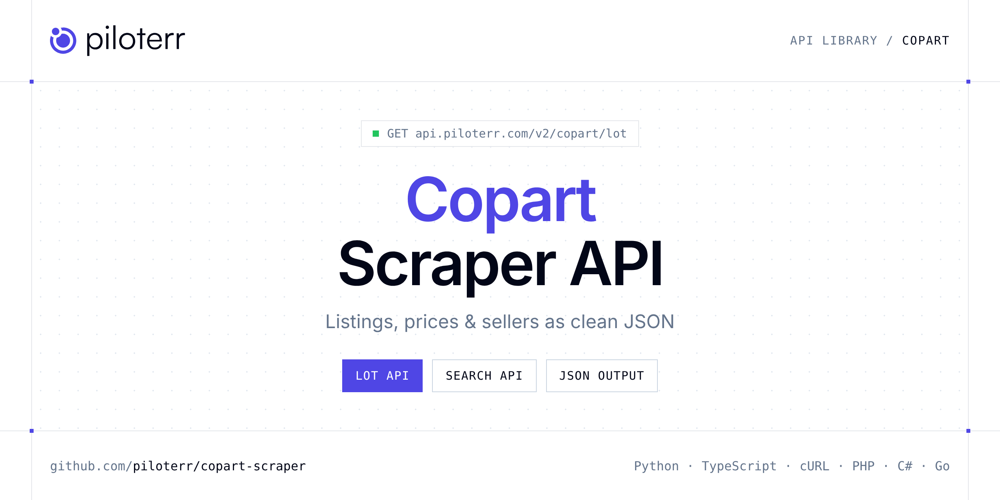

<p align="center">
  <a href="https://www.piloterr.com"></a>
</p>

# Copart Scraper API

[](https://discord.gg/CFj3ph8aHU) [](https://app.piloterr.com) [](https://app.piloterr.com/openapi) [](LICENSE)

The **Piloterr Copart Scraper API** lets you extract public data from Copart as **clean, structured JSON** — no proxies, headless browsers or HTML parsing to maintain. Endpoints available in production:

- **Copart Lot API** — Copart Lot API: retrieve structured auction lot data by lot number or URL.
- **Copart Search API** — Copart Search API: search auction lots by keyword or URL across Copart regional sites.

Use it for listing monitoring, price benchmarks, stock sourcing or market analytics on second-hand and vehicle marketplaces.

| Endpoint | Path | Credits | What you get |
|---|---|---|---|
| [Copart Lot API](#copart-lot-api) | `/v2/copart/lot` | 2 | Copart Lot API |
| [Copart Search API](#copart-search-api) | `/v2/copart/search` | 2 | Copart Search API |

## Table of contents

- [How it works](#how-it-works)
- [Copart Lot API](#copart-lot-api)
- [Copart Search API](#copart-search-api)
- [Code examples in other languages](#code-examples-in-other-languages)
- [Practical use cases](#practical-use-cases)
- [Why Piloterr?](#why-piloterr)
- [FAQ](#faq)
- [Related scrapers](#related-scrapers)
- [Support](#support)

## How it works

1. **Create a free Piloterr account** and copy your API key from the [dashboard](https://app.piloterr.com).
2. **Send a `GET` (or `POST`) request** to `https://api.piloterr.com/v2/...` with the header `x-api-key: YOUR_API_KEY`.
3. **Receive structured JSON** — Piloterr handles rendering, proxies, retries and parsing.

```bash
export PILOTERR_API_KEY="your-api-key"
pip install requests        # Python
# TypeScript: Node.js 18+ (native fetch), run with `npx tsx file.ts`
```

> Every endpoint accepts both `GET` (query string) and `POST` (JSON body with the same fields).

## Copart Lot API

Copart Lot API: retrieve structured auction lot data by lot number or URL. Specs, damage, bids, photos, yard location and sale status across regional Copart sites.

`GET | POST https://api.piloterr.com/v2/copart/lot` · **2 credits per request** · [Full reference](https://app.piloterr.com/openapi)

### Request parameters

| Parameter | Type | Required | Description |
|---|---|---|---|
| `query` | string | ✅ | Copart lot number or full lot URL. |
| `region` | string | — | Regional Copart site when `query` is a lot number only. Defaults to US. |
| `return_page_source` | boolean | — | When `true`, return the raw HTML page source as `{"result": "..."}` instead of structured JSON. Defaults to `false`. |

### Python example

```python
import json
import os
import requests

response = requests.get(
    "https://api.piloterr.com/v2/copart/lot",
    headers={"x-api-key": os.environ["PILOTERR_API_KEY"]},
    params={
        "query": "55295666",
    },
    timeout=60,
)
response.raise_for_status()
data = response.json()

print(json.dumps(data, indent=2, ensure_ascii=False)[:2000])
```

### TypeScript example

```typescript
type CopartLot = {
  id?: string;
  lic?: string[];
  url?: string;
  fuel?: string;
  keys?: string;
  make?: string;
  year?: number;
  color?: string;
  drive?: string;
  model?: string;
  title?: string;
  engine?: string;
  images?: string[];
  currency?: string;
  latitude?: number;
  lot_sold?: boolean;
  odometer?: number;
  image_url?: string;
  longitude?: number;
  sale_date?: string;
  yard_city?: string;
  yard_name?: string;
  bid_status?: string;
  buy_it_now?: boolean;
  run_status?: string;
  [key: string]: unknown;
};

const params = new URLSearchParams({
  "query": "55295666",
});

const response = await fetch(`https://api.piloterr.com/v2/copart/lot?${params}`, {
  headers: { "x-api-key": process.env.PILOTERR_API_KEY! },
});
if (!response.ok) throw new Error(`Piloterr error ${response.status}: ${await response.text()}`);

const data = (await response.json()) as CopartLot;

console.log(JSON.stringify(data, null, 2).slice(0, 2000));
```

<details>
<summary><b>POST variant</b></summary>

```http
POST https://api.piloterr.com/v2/copart/lot
x-api-key: YOUR_API_KEY
Content-Type: application/json

{"query": "55295666"}
```
</details>

### Output example

Example response from the API reference, abridged — real values depend on the page you scrape.

```json
{
  "id": "55295666",
  "lic": [
    "ADDL-INFO",
    "CERT-D"
  ],
  "url": "https://www.copart.co.uk/lot/55295666/clean-title-2014-porsche-panamera-4-8-v8-gts-4dr-pdk-sandy",
  "fuel": "PETROL",
  "keys": "YES",
  "make": "PORSCHE",
  "year": 2014,
  "color": "GREY",
  "drive": "2 AXLE RIGID BODY",
  "model": "PANAMERA G",
  "title": "2014 PORSCHE PANAMERA 4.8 V8 GTS 4DR PDK",
  "engine": "4806 cc",
  "images": [
    "https://cs.copart.com/v1/AUTH_svc.pdoc00001/lpp/0626/7834e4c0e5da4ef3809e87b2e31a987d_thb.jpg"
  ],
  "currency": "GBP",
  "latitude": 52.14,
  "lot_sold": false,
  "odometer": 74190,
  "image_url": "https://cs.copart.com/v1/AUTH_svc.pdoc00001/lpp/0626/7834e4c0e5da4ef3809e87b2e31a987d_thb.jpg",
  "longitude": -0.3,
  "sale_date": "2026-07-01T09:00:00+00:00",
  "yard_city": "SANDY",
  "yard_name": "SANDY",
  "bid_status": "NEVER_BID",
  "buy_it_now": true,
  "run_status": "RUNS AND DRIVES"
}
```

### Response fields

| Field | Type | Description |
|---|---|---|
| `id` | string |  |
| `lic` | string[] |  |
| `url` | string |  |
| `fuel` | string |  |
| `keys` | string |  |
| `make` | string |  |
| `year` | integer |  |
| `color` | string |  |
| `drive` | string |  |
| `model` | string |  |
| `title` | string |  |
| `engine` | string |  |
| `images` | string[] |  |
| `currency` | string |  |
| `latitude` | number |  |
| `lot_sold` | boolean |  |
| `odometer` | integer |  |
| `image_url` | string |  |
| `longitude` | number |  |
| `sale_date` | string |  |
| `yard_city` | string |  |
| `yard_name` | string |  |
| `bid_status` | string |  |
| `buy_it_now` | boolean |  |
| `run_status` | string |  |

## Copart Search API

Copart Search API: search auction lots by keyword or URL across Copart regional sites. Returns lot listings and pagination.

`GET | POST https://api.piloterr.com/v2/copart/search` · **2 credits per request** · [Full reference](https://app.piloterr.com/openapi)

### Request parameters

| Parameter | Type | Required | Description |
|---|---|---|---|
| `query` | string | ✅ | Search keyword or full Copart search URL. |
| `region` | string | — | Copart regional site when `query` is a keyword or lot number only. Defaults to US. |
| `page` | number | — | Page number (default: 1). |
| `return_page_source` | boolean | — | When `true`, return the raw HTML page source as `{"result": "..."}` instead of structured JSON. Defaults to `false`. |

### Python example

```python
import json
import os
import requests

response = requests.get(
    "https://api.piloterr.com/v2/copart/search",
    headers={"x-api-key": os.environ["PILOTERR_API_KEY"]},
    params={
        "query": "chevrolet",
    },
    timeout=60,
)
response.raise_for_status()
data = response.json()

print(json.dumps(data, indent=2, ensure_ascii=False)[:2000])
```

### TypeScript example

```typescript
type CopartSearch = {
  results?: {
    id?: string;
    url?: string;
    title?: string;
    region?: string;
    image_url?: string;
  }[];
  pagination?: {
    next?: string;
    page?: number;
    region?: string;
    keyword?: string;
    per_page?: number;
    total_pages?: number;
    total_results?: number;
  };
};

const params = new URLSearchParams({
  "query": "chevrolet",
});

const response = await fetch(`https://api.piloterr.com/v2/copart/search?${params}`, {
  headers: { "x-api-key": process.env.PILOTERR_API_KEY! },
});
if (!response.ok) throw new Error(`Piloterr error ${response.status}: ${await response.text()}`);

const data = (await response.json()) as CopartSearch;

console.log(JSON.stringify(data, null, 2).slice(0, 2000));
```

<details>
<summary><b>POST variant</b></summary>

```http
POST https://api.piloterr.com/v2/copart/search
x-api-key: YOUR_API_KEY
Content-Type: application/json

{"query": "chevrolet"}
```
</details>

### Output example

Example response from the API reference, abridged — real values depend on the page you scrape.

```json
{
  "results": [
    {
      "id": "99998285",
      "url": "https://www.copart.com/lot/99998285/2018-chevrolet-volt-lt-ky-walton",
      "title": "Lot Details",
      "region": "www.copart.com",
      "image_url": "https://cs.copart.com/v1/AUTH_svc.pdoc00001/lpp/0126/c52d88ab17584eef8aaeec778bfd0cf7_thb.jpg"
    },
    {
      "id": "99997735",
      "url": "https://www.copart.com/lot/99997735/2017-chevrolet-silverado-k1500-high-country-ky-louisville",
      "title": "Lot Details",
      "region": "www.copart.com",
      "image_url": "https://cs.copart.com/v1/AUTH_svc.pdoc00001/lpp/0126/24b81615824643148af9cd947ab96c3c_thb.jpg"
    }
  ],
  "pagination": {
    "next": "https://www.copart.com/lotSearchResults?free=true&query=chevrolet&page=2",
    "page": 1,
    "region": "www.copart.com",
    "keyword": "chevrolet",
    "per_page": 20,
    "total_pages": 500,
    "total_results": 10000
  }
}
```

### Response fields

| Field | Type | Description |
|---|---|---|
| `results[]` | object[] |  |
| `results[].id` | string |  |
| `results[].url` | string |  |
| `results[].title` | string |  |
| `results[].region` | string |  |
| `results[].image_url` | string |  |
| `pagination` | object |  |
| `pagination.next` | string |  |
| `pagination.page` | integer |  |
| `pagination.region` | string |  |
| `pagination.keyword` | string |  |
| `pagination.per_page` | integer |  |
| `pagination.total_pages` | integer |  |
| `pagination.total_results` | integer |  |

## Code examples in other languages

Ready-to-run examples live in the [`examples/`](examples) folder. Each one reads your key from the `PILOTERR_API_KEY` environment variable.

| Language | Lot | Search |
|---|---|---|
| cURL (Bash) | [`lot`](examples/curl/lot.sh) | [`search`](examples/curl/search.sh) |
| PHP | [`lot`](examples/php/lot.php) | [`search`](examples/php/search.php) |
| C# | [`lot`](examples/csharp/Lot.cs) | [`search`](examples/csharp/Search.cs) |
| Go | [`lot`](examples/go/lot.go) | [`search`](examples/go/search.go) |
| Java | [`lot`](examples/java/LotExample.java) | [`search`](examples/java/SearchExample.java) |
| Ruby | [`lot`](examples/ruby/lot.rb) | [`search`](examples/ruby/search.rb) |
| Node.js | [`lot`](examples/nodejs/lot.mjs) | [`search`](examples/nodejs/search.mjs) |

## Practical use cases

- **Listing monitoring** — Get alerted when new ads matching your criteria are published.
- **Price benchmarks** — Compute market prices per model, category or location.
- **Sourcing** — Find stock, vehicles, parts or equipment faster than manual browsing.
- **Market analytics** — Measure supply, turnover and pricing trends over time.
- **Data products** — Feed valuation models and dashboards with structured listings.

## Why Piloterr?

- **No infrastructure** — no proxies, headless browsers or CAPTCHA solving to run yourself.
- **Structured JSON** — stable, documented fields instead of brittle HTML selectors.
- **Pay per request** — transparent credit cost per endpoint, failed requests are retried for you.
- **One API key, hundreds of sources** — Copart plus many other e-commerce, search and company data endpoints in the [Piloterr library](https://www.piloterr.com/library).
- **Any language** — plain HTTPS + JSON, with examples for Python, TypeScript, cURL, PHP, C#, Go, Java, Ruby and Node.js.

## FAQ

### Is it legal to scrape Copart?

Collecting publicly available data is generally allowed in many jurisdictions, but rules depend on your country, the data you collect and how you use it. Avoid personal data unless you have a lawful basis, respect the website's terms where they apply, and get legal advice for your specific use case. This is not legal advice.

### Do I need proxies or a headless browser?

No. Piloterr handles rendering, proxy rotation and retries on its side. You only send an HTTPS request with your `x-api-key` header and receive JSON.

### How much does a request cost?

Credits per call: `/v2/copart/lot` **2**, `/v2/copart/search` **2**. See the [Piloterr website](https://www.piloterr.com) for plans.

### What data does the Copart API return?

Each endpoint returns structured JSON: **Copart Lot** — `id`, `lic`, `url`, `fuel`, `keys`, `make`; **Copart Search** — `results[]`, `results[].id`, `results[].url`, `results[].title`, `results[].region`, `results[].image_url`.

### How do I paginate Copart results?

Use the `page` parameter and keep requesting while the response indicates more results.

### Can I target a specific country or language?

Yes, use `region` — see the parameter tables above for accepted values.

### Can I get the raw HTML instead of JSON?

Yes. Set `return_page_source=true` and the response becomes `{"result": "..."}` with the page source.

### Which languages are supported?

Any language that can make an HTTP request. This README shows Python and TypeScript; the [`examples/`](examples) folder contains cURL, PHP, C#, Go, Java, Ruby and Node.js.

## Related scrapers

- [AutoScout24 Scraper API](https://github.com/piloterr/autoscout24-scraper)
- [Autotrader Scraper API](https://github.com/piloterr/autotrader-scraper)
- [Kijiji Scraper API](https://github.com/piloterr/kijiji-scraper)
- [Leboncoin Scraper API](https://github.com/piloterr/leboncoin-scraper)
- [Mascus Scraper API](https://github.com/piloterr/mascus-scraper)
- [mobile.de Scraper API](https://github.com/piloterr/mobile-de-scraper)
- [All Piloterr scrapers on GitHub](https://github.com/piloterr)

## Support

- 💬 Join the [Piloterr Discord](https://discord.gg/CFj3ph8aHU) to ask questions and share what you build.
- 📚 Browse the [API reference (OpenAPI)](https://app.piloterr.com/openapi) and the [Piloterr library](https://www.piloterr.com/library).
- 🔑 [Get your API key](https://app.piloterr.com).

---

<p align="center">
  <a href="https://www.piloterr.com">
    <picture>
      <source media="(prefers-color-scheme: dark)" srcset="images/logo-dark.svg">
      
    </picture>
  </a>
  <br>
  <sub>Built by <a href="https://www.piloterr.com">Piloterr</a> — web scraping APIs for e-commerce, search, real estate and more, one API key.</sub>
</p>

<sub>Copart is a trademark of its respective owner. This repository is not affiliated with or endorsed by Copart. Examples are released under the MIT license.</sub>
